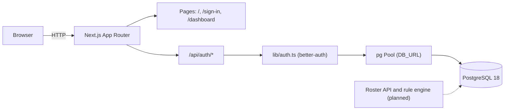

# Architecture

This document describes how Shiftly is structured: the parts of the system, how they talk to each other, where code lives, the key decisions, and how the app is configured and deployed. It marks what is built and what is planned. Product requirements are in the [PRD](PRD.md), the data model is in [DATABASE.md](DATABASE.md), and the test strategy is in [TESTING.md](TESTING.md).

## Overview

The app is a single Next.js project with no separate backend service. Route handlers under `app/api/` serve the API. The PRD specifies Next.js for both the frontend and the API, and roster APIs are planned to run the same way.

Built today: a landing page, a sign-in route that is still a stub, a dashboard that uses template data, authentication through better-auth, and the auth tables in PostgreSQL.

Not built yet: the roster domain, the rule engine, Excel import and export, and the form output.

## Components

| Component | Location | Responsibility | Status |
| --- | --- | --- | --- |
| Landing page | `app/page.tsx`, `components/home/` | Public marketing page | Built |
| Sign-in page | `app/sign-in/page.tsx` | Login screen | Stub. Renders `null` |
| Dashboard | `app/dashboard/`, `components/dashboard/` | Admin layout with sidebar, header, and a table and chart | Built with template data (`app/dashboard/data.json`) |
| Auth API | `app/api/auth/[...all]/route.ts` | Passes all better-auth requests to the auth handler | Built |
| Auth configuration | `lib/auth.ts` | Creates the better-auth instance with the Drizzle adapter and email and password login | Built |
| Auth client | `lib/auth-client.ts` | Client helper for the browser | Built. Not used by any page yet |
| Database schema | `database/schema/auth-schema.ts` | Source of truth for the tables | Auth tables only |
| Migrations | `database/migration/` | SQL generated by drizzle-kit | Built |
| Roster domain | See [Folder layout](#folder-layout) | Sites, departments, employees, shifts, requests, rosters | Planned |
| Rule engine | See [Folder layout](#folder-layout) | Builds a roster and validates each rule | Planned |

## Folder layout

| Path | Contents |
| --- | --- |
| `app/` | Routes: `/`, `/sign-in`, `/dashboard`, and the API under `app/api/` |
| `components/home/`, `components/dashboard/` | Landing page and dashboard blocks |
| `components/ui/` | shadcn/ui primitives |
| `lib/` | `auth.ts`, `auth-client.ts`, and `utils.ts` |
| `hooks/` | Shared React hooks, such as `use-mobile.ts` |
| `database/schema/` | Drizzle schema files. `drizzle.config.ts` reads every `*.ts` file in this folder |
| `database/migration/` | SQL migrations generated by drizzle-kit |
| `docs/` | Project documentation |

Where the planned code will go. This is a proposal, not a decision yet:

- **Rule engine:** plain TypeScript under `lib/roster/`, with no imports from Next.js or the database. This keeps the engine testable with Vitest in the `node` environment (see [TESTING.md](TESTING.md)).
- **Roster tables:** `database/schema/roster-schema.ts`. The existing Drizzle config picks it up without changes.
- **Roster pages:** under `app/dashboard/`.

## Request flows

**Sign-up and sign-in (current)**

1. The browser calls `/api/auth/*`.
2. The route handler in `app/api/auth/[...all]/route.ts` passes the request to the better-auth instance from `lib/auth.ts`.
3. better-auth reads and writes the `user`, `session`, `account`, and `verification` tables through the Drizzle adapter and a `pg` pool.

Email and password login is the only enabled method (`emailAndPassword: { enabled: true }`).

**Roster generation (planned)**

1. An admin creates a request for one site and one or more departments. The request is either daily or weekly.
2. The API stores the request. It then loads the PKDW employees for the site, with their off and break history, and their last shift and count of consecutive working days from roster history.
3. The rule engine builds the schedule and validates each rule: work pattern, shift change, break, and annual off.
4. If a rule cannot be met, the engine records a conflict and its reason. It does not skip the rule.
5. A roster with no conflicts is saved and shown per site and department. Weekly requests wait for approval before the roster becomes final.

## Key decisions

| Decision | Status | Source |
| --- | --- | --- |
| Next.js serves both the frontend and the API | Built | PRD, Spesifikasi teknis |
| PostgreSQL 18 with Drizzle ORM | Built | [DATABASE.md](DATABASE.md), `lib/auth.ts` |
| better-auth with email and password login | Built | `lib/auth.ts` |
| The rule engine is deterministic and uses no AI model. The same input gives the same roster | Planned | PRD, Spesifikasi AI |
| A rule that cannot be met is recorded as a conflict with its reason. It is never skipped | Planned | PRD, Alur data |
| The shift-change check uses the last shift and consecutive working days from roster history | Planned | PRD, Spesifikasi teknis |
| Roster history is stored and never overwritten, for audit | Planned | PRD, Keamanan dan privasi |
| Hosting for the Next.js app | Open | PRD, Spesifikasi teknis (listed as TBD) |

## Authentication and authorization

**Current state**

- better-auth runs on the server. Login and sign-up use email and password.
- No code checks the session on the server. There is no `proxy.ts` or `middleware.ts`, and the dashboard layout does not call `auth.api.getSession`. Anyone who opens `/dashboard` can see it.
- The sign-in page is a stub. `authClient` is defined but not used.

**Target state**

- Only logged-in users can reach admin pages. The check runs on the server, not only in the UI.
- There are three roles: superadmin, HO, and admin site. All three are in the MVP, together with multi-site. Each role decides which sites the user can see and which actions they can take. Source: PRD, Role.

Protecting the dashboard is a required step before the roster features are built.

## Configuration

Copy `.env.example` to `.env`. Do not commit `.env`.

| Variable | Read by | Purpose |
| --- | --- | --- |
| `DB_USER`, `DB_PASSWORD`, `DB_NAME` | `compose.yaml`, `compose.prod.yaml`, `drizzle.config.ts` | Database credentials |
| `DB_HOST`, `DB_PORT` | `drizzle.config.ts`, Compose | Database host and host port |
| `DB_URL` | `lib/auth.ts` | Connection string for the app's `pg` pool |
| `BETTER_AUTH_SECRET` | better-auth (read by the library from the environment) | Signing secret. Generate with `openssl rand -base64 32` |
| `BETTER_AUTH_URL` | Listed in `.env.example` | See note below |

**Note:** `lib/auth.ts` sets `baseURL` to the literal `http://localhost:3000/`. The `BETTER_AUTH_URL` value in `.env.example` is not read by that file. Change `baseURL` in `lib/auth.ts` before deploying to another address.

Next.js settings are in `next.config.ts`. `cacheComponents` is enabled, and the Turbopack config adds the Tailwind loader for CSS files.

## Deployment

| Environment | Database | Command | Notes |
| --- | --- | --- | --- |
| Local development | `compose.yaml`, service `postgres`, container `shiftly-postgres` | `docker compose up -d`, then `bun dev` | Port `${DB_PORT}` is exposed on all interfaces |
| Production database | `compose.prod.yaml`, container `shiftly-postgres-prod` | `docker compose -f compose.prod.yaml up -d` | Port is bound to `127.0.0.1` only. Restart policy is `always`. Logs are capped at 3 files of 10 MB |

The production database service is defined. Hosting for the Next.js app is not decided. The README still contains the default `create-next-app` text, including the Vercel deploy section. Do not treat it as the deployment plan.

## Known gaps

- The dashboard has no server-side auth check.
- The sign-in page is empty.
- `lib/auth.ts` hardcodes `baseURL`. See [Configuration](#configuration).
- The dashboard shows template data from `app/dashboard/data.json`, not roster data.
- No roster tables or rule engine exist. The entities they need are listed in [DATABASE.md](DATABASE.md#not-yet-implemented).
- Hosting and the app's deployment target are undecided. See [Deployment](#deployment).
