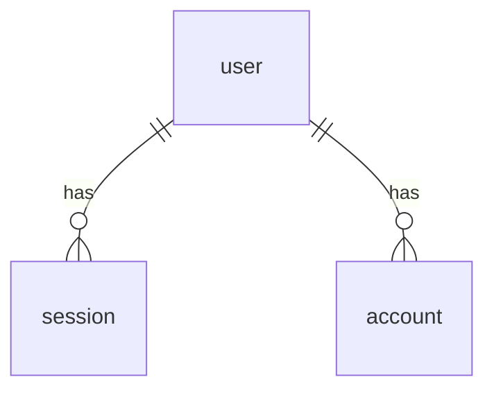

# Database

This document describes the database used by Shiftly: connection, tables, relations, and how to run migrations.

Shiftly uses PostgreSQL 18 with Drizzle ORM. Authentication uses better-auth, which stores its data in four tables. Only the authentication tables are modeled so far. Tables for roster data do not exist yet (see [Not yet implemented](#not-yet-implemented)).

## Connection configuration

The connection is read from the `.env` file in the project root. Example values are in `.env.example`. Do not commit `.env`.

| Variable      | Used by                             | Description                                     |
| ------------- | ----------------------------------- | ----------------------------------------------- |
| `DB_USER`     | `compose.yaml`, `drizzle.config.ts` | PostgreSQL user name                            |
| `DB_PASSWORD` | `compose.yaml`, `drizzle.config.ts` | PostgreSQL user password                        |
| `DB_HOST`     | `drizzle.config.ts`                 | Database host                                   |
| `DB_PORT`     | `compose.yaml`, `drizzle.config.ts` | Database port on the host                       |
| `DB_NAME`     | `compose.yaml`, `drizzle.config.ts` | Database name                                   |
| `DB_URL`      | `lib/auth.ts`                       | Connection string for the better-auth pool      |

`DB_URL` is built from the other variables, in the format `postgresql://<DB_USER>:<DB_PASSWORD>@<DB_HOST>:<DB_PORT>/<DB_NAME>`.

## Database service

The PostgreSQL service is defined in `compose.yaml`.

| Property       | Value                                                        |
| -------------- | ------------------------------------------------------------ |
| Image          | `postgres:18.3`                                              |
| Container name | `shiftly-postgres`                                           |
| Port           | `${DB_PORT}` on the host to `5432` in the container          |
| Volume         | `shiftly-postgres-data`, mounted at `/var/lib/postgresql`    |
| Restart        | `unless-stopped`                                             |
| Health check   | `pg_isready` every 5 seconds, 3-second timeout, 10 retries   |

`compose.yaml` requires `DB_USER`, `DB_NAME`, and `DB_PASSWORD` to be set. If any is missing, Compose stops with an error.

`compose.prod.yaml` defines the production PostgreSQL service. It uses the container `shiftly-postgres-prod`, binds its port to `127.0.0.1` only, and requires `DB_PORT` to be set. See [ARCHITECTURE.md](ARCHITECTURE.md#deployment) for how each environment is started.

## File layout

| File                                    | Contents                                                         |
| --------------------------------------- | ---------------------------------------------------------------- |
| `database/schema/auth-schema.ts`        | Drizzle table and relation definitions. The source of truth for the schema. |
| `database/migration/`                   | SQL migration files and the `meta` folder, generated by drizzle-kit |
| `database/migration/0000_init_auth.sql` | Initial migration that creates the four authentication tables     |
| `drizzle.config.ts`                     | drizzle-kit configuration: dialect, schema location, and credentials |
| `lib/auth.ts`                           | better-auth setup with the Drizzle adapter                        |

## Authentication tables

better-auth creates all four tables. Column names use `snake_case` in the database. The Drizzle properties use `camelCase`.

### `user`

User account data.

| Column           | Type        | Null | Default | Description                                                        |
| ---------------- | ----------- | ---- | ------- | ------------------------------------------------------------------ |
| `id`             | `text`      | No   | -       | Primary key                                                        |
| `name`           | `text`      | No   | -       | User's name                                                        |
| `email`          | `text`      | No   | -       | Unique                                                             |
| `email_verified` | `boolean`   | No   | `false` | Whether the email is verified                                      |
| `image`          | `text`      | Yes  | -       | Profile picture URL                                                |
| `created_at`     | `timestamp` | No   | `now()` | When the row was created                                           |
| `updated_at`     | `timestamp` | No   | `now()` | When the row was last changed. Set by Drizzle when the row is updated through the application |

### `session`

Login sessions. One user can have several sessions.

| Column       | Type        | Null | Default | Description                                         |
| ------------ | ----------- | ---- | ------- | --------------------------------------------------- |
| `id`         | `text`      | No   | -       | Primary key                                         |
| `expires_at` | `timestamp` | No   | -       | When the session expires                            |
| `token`      | `text`      | No   | -       | Session token. Unique                               |
| `created_at` | `timestamp` | No   | `now()` | When the row was created                            |
| `updated_at` | `timestamp` | No   | -       | When the row was last changed                       |
| `ip_address` | `text`      | Yes  | -       | IP address at login                                 |
| `user_agent` | `text`      | Yes  | -       | Browser user agent at login                         |
| `user_id`    | `text`      | No   | -       | References `user.id`. Deleted when the user is deleted |

Index: `session_userId_idx` on `user_id`.

### `account`

Accounts linked to a user. One user can have several accounts, for example email and password login plus an OAuth provider.

| Column                     | Type        | Null | Default | Description                                              |
| -------------------------- | ----------- | ---- | ------- | -------------------------------------------------------- |
| `id`                       | `text`      | No   | -       | Primary key                                              |
| `account_id`               | `text`      | No   | -       | Account ID at the provider                               |
| `provider_id`              | `text`      | No   | -       | Provider name, for example `credential` for email and password |
| `user_id`                  | `text`      | No   | -       | References `user.id`. Deleted when the user is deleted   |
| `access_token`             | `text`      | Yes  | -       | Access token from the OAuth provider                     |
| `refresh_token`            | `text`      | Yes  | -       | Refresh token from the OAuth provider                    |
| `id_token`                 | `text`      | Yes  | -       | ID token from the OAuth provider                         |
| `access_token_expires_at`  | `timestamp` | Yes  | -       | When the access token expires                            |
| `refresh_token_expires_at` | `timestamp` | Yes  | -       | When the refresh token expires                           |
| `scope`                    | `text`      | Yes  | -       | Scope granted by the provider                            |
| `password`                 | `text`      | Yes  | -       | Password for email and password login                    |
| `created_at`               | `timestamp` | No   | `now()` | When the row was created                                 |
| `updated_at`               | `timestamp` | No   | -       | When the row was last changed                            |

Index: `account_userId_idx` on `user_id`.

### `verification`

Temporary tokens for verification, such as email verification or password reset.

| Column       | Type        | Null | Default | Description                                  |
| ------------ | ----------- | ---- | ------- | -------------------------------------------- |
| `id`         | `text`      | No   | -       | Primary key                                  |
| `identifier` | `text`      | No   | -       | Request identifier, usually an email address |
| `value`      | `text`      | No   | -       | Token value                                  |
| `expires_at` | `timestamp` | No   | -       | When the token expires                       |
| `created_at` | `timestamp` | No   | `now()` | When the row was created                     |
| `updated_at` | `timestamp` | No   | `now()` | When the row was last changed                |

Index: `verification_identifier_idx` on `identifier`.

## Relations

- `session.user_id` and `account.user_id` reference `user.id` with `ON DELETE CASCADE`. Deleting a user also deletes their sessions and accounts.
- `verification` has no relation to other tables.

## Migrations

drizzle-kit commands are run with `bunx`. `package.json` does not have database scripts yet.

| Command                     | What it does                                                          |
| --------------------------- | --------------------------------------------------------------------- |
| `bunx drizzle-kit generate` | Creates SQL migration files in `database/migration/` from schema changes |
| `bunx drizzle-kit migrate`  | Applies migration files to the database                               |
| `bunx drizzle-kit push`     | Syncs the database directly to the schema without migration files     |
| `bunx drizzle-kit studio`   | Opens a web UI for viewing and editing data                           |

All commands read credentials from `.env` through `drizzle.config.ts`. Make sure `.env` exists and the `shiftly-postgres` container is running.

`push` does not create migration files, so its changes are not recorded in the migration history. For shared databases, use `generate` and `migrate`.

## Not yet implemented

The following tables are needed by the [PRD](PRD.md) but are not modeled yet:

- Site, department, and sub-department
- PKDW employees and their positions
- Employee membership in multiple departments
- Shifts and their hours per site
- Roster requests, rosters, and rule conflicts
- Annual off and break history
- User roles (superadmin, HO, and admin site) and site assignment

Some decisions in the PRD are still open and affect the design of these tables. For example, the unique employee identifier (NIK or employee ID) and how to handle employees who belong to more than one department.
